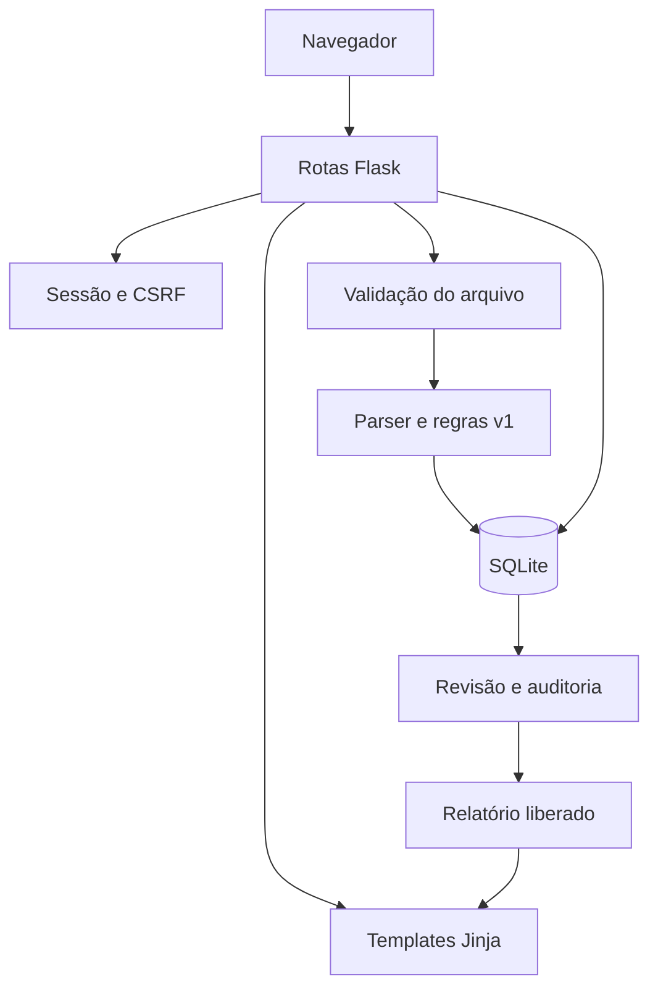
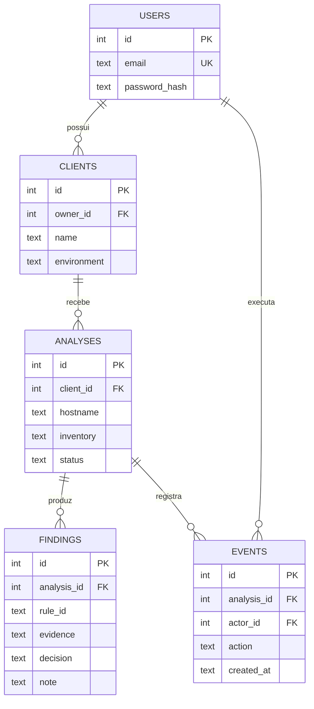

# Arquitetura do Sistema — Netrunner OT

Etapa 3 · 21/10/2026. Arquitetura implementada para demonstração local e evolução incremental.

## 1. Stack e decisões

| Camada | Tecnologia | Justificativa e limite |
|---|---|---|
| Backend | Python 3.12 e Flask 3.1.2 | Integra parser, regras e rotas em projeto pequeno |
| Frontend | HTML5, Jinja2 e CSS responsivo | Telas reais renderizadas no servidor; sem cadeia de build JavaScript |
| Banco | SQLite, módulo `sqlite3` | Persistência local simples; PostgreSQL é evolução para concorrência e operação centralizada |
| Autenticação | Sessão assinada Flask e hash Werkzeug | Usuários criados por CLI; papéis e recuperação de senha pendentes |
| Testes | pytest e cliente de testes Flask | Regras, fluxos, validação e isolamento |
| Versionamento | Git, branches e pull requests | Evolução em `feature/*`, integração em `develop`, entrega em `main` |

Dependências diretas estão fixadas em [requirements.txt](requirements.txt) e [requirements-dev.txt](requirements-dev.txt). Dependências transitivas são resolvidas pelo pip; lock completo e atualização periódica ficam como evolução de reprodutibilidade.

## 2. Componentes

O arquivo bruto é processado em memória e descartado após a requisição. Inventário resumido, achados, decisões e eventos ficam persistidos. Não há conexão com dispositivos, execução de comandos, chamadas de IA ou envio de configuração para serviços externos.

## 3. Modelo de dados

Um cadastro representa o par cliente/ambiente. Todas as consultas de análises verificam `clients.owner_id`. Chaves estrangeiras são ativadas a cada conexão. A exclusão de análise remove achados e eventos em cascata. Datas de banco são armazenadas e exibidas em UTC.

## 4. Rotas implementadas

| Método | Rota | Comportamento |
|---|---|---|
| GET/POST | `/login` | Acesso por e-mail e senha |
| POST | `/logout` | Encerra sessão |
| GET | `/` | Indicadores e análises do consultor |
| GET/POST | `/clientes` | Lista e cadastra cliente/ambiente |
| GET/POST | `/analises/nova` | Valida upload e grava análise |
| GET | `/analises/<id>` | Inventário, achados e auditoria |
| POST | `/analises/<id>/achados/<finding_id>` | Registra decisão e revoga liberação anterior |
| POST | `/analises/<id>/liberar` | Exige ausência de pendências e revisão final |
| GET | `/analises/<id>/relatorio` | Renderiza somente análise liberada |
| POST | `/analises/<id>/excluir` | Exige confirmação textual e propriedade |

As rotas retornam HTML, não uma API JSON pública. Identificadores de terceiros retornam 404. Relatório próprio ainda não liberado retorna 403. Requisições acima do limite retornam 413.

## 5. Catálogo inicial e limites do parser

| Regra | Condição | Interpretação |
|---|---|---|
| NET-001 | `transport input` permite Telnet ou `all` | Acesso inseguro explicitado |
| NET-002 | Linha `ip http server` | HTTP explicitamente habilitado |
| NET-003 | Linha `switchport trunk allowed vlan all` | Todas as VLANs explicitamente permitidas |
| NET-004 | Não localizar `ntp server` ou `ntp peer` | Informação a confirmar |
| NET-005 | Não localizar destino remoto de logging | Informação a confirmar |
| NET-006 | Não localizar `ip ssh version 2` | Informação a confirmar |

O parser é textual e parcial. Exige `hostname` e pelo menos uma `interface`, mas não certifica fabricante, versão ou sintaxe completa. Não interpreta blocos de banner, herança, defaults ou toda a hierarquia IOS. Portanto, achados são preliminares e podem exigir descarte pelo consultor. São seis regras; a meta de pelo menos 20 da especificação continua em aberto na [issue 3](https://github.com/Kakashi0101/NetRunner/issues/3).

## 6. Segurança implementada e pendências

Implementados: hash de senha, sessão assinada, cookie HttpOnly/SameSite, CSRF em POST, SQL parametrizado, escape HTML, autorização por proprietário, limite de upload, bloqueio de padrões sensíveis e cabeçalhos CSP/nosniff/frame. A chave de sessão é gerada localmente ou definida em `NETRUNNER_SECRET` e nunca deve ser versionada.

O detector não garante anonimização completa. IPs, topologia e segredos em formatos desconhecidos podem permanecer em evidências. O banco não tem criptografia de aplicação em repouso. A exclusão remove registros da base ativa, sem promessa de sobrescrita física ou remoção de backups. O acesso de múltiplos consultores à mesma organização, papéis cliente/admin, rate limiting, retenção automática, recuperação de senha e recuperação de backups ainda não estão implementados.

Nesta etapa, executar em `127.0.0.1` com configurações sintéticas. Para exposição externa: servidor WSGI apropriado, HTTPS, cookie Secure (`NETRUNNER_HTTPS=1`), gestão de segredo, política de retenção, backup e controles pendentes da [issue 5](https://github.com/Kakashi0101/NetRunner/issues/5). O servidor de desenvolvimento Flask não é arquitetura de produção.

## 7. Evolução planejada

1. Completar regras e testes por plataforma e versão.
2. Introduzir migrações de esquema e PostgreSQL quando houver operação centralizada.
3. Separar camadas de persistência e serviço à medida que o código crescer.
4. Adicionar medição de horas, histórico comparativo e controle de franquias.
5. Integrar IA somente com consentimento, anonimização validada, limites e contingência.
6. Adicionar portal do cliente, permissões e exportação estruturada.

## 8. Validação

Executar `python -m pytest -q`. A suíte inicial contém 16 casos, incluindo parametrizações: extração, regras, entradas vazias/binárias, segredos, autenticação, CSRF, isolamento, revisão, revogação de relatório, exclusão e persistência. O [registro de testes](docs/VALIDACAO.md) identifica o que foi efetivamente executado.

Referências de implementação: [Flask](https://flask.palletsprojects.com/), [SQLite](https://www.sqlite.org/docs.html) e [pytest](https://docs.pytest.org/). O código e os testes do repositório são a evidência da arquitetura desta versão.
