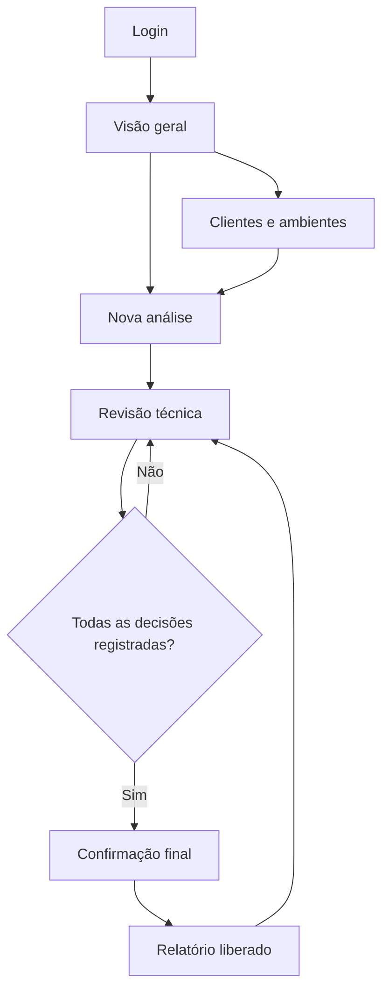

# Projeto de Interface — Netrunner OT

Etapa 3 · 21/10/2026. Esta documentação descreve telas implementadas em HTML/Jinja e CSS, conectadas ao backend Flask e ao SQLite. Não são apenas protótipos navegáveis.

## 1. Usuário e tarefa principal

O usuário implementado é o consultor autenticado. Ele cadastra um cliente/ambiente, envia uma configuração sintética ou anonimizada, revisa evidências e libera um relatório. O portal do cliente e o perfil de administrador permanecem planejados.

## 2. Mapa de navegação

Uma alteração em um achado revoga a liberação anterior. O consultor precisa liberar novamente o relatório após a revisão.

## 3. Telas e comportamentos implementados

| Tela | Campos ou componentes | Ação real no backend | Estados relevantes |
|---|---|---|---|
| Login | E-mail e senha | Valida hash e cria sessão | Credenciais incorretas, sessão expirada |
| Visão geral | Indicadores e tabela de diagnósticos | Consulta registros do usuário | Carteira vazia, análises em revisão ou liberadas |
| Clientes | Nome e ambiente | Valida e grava no SQLite | Vazio, sucesso, comprimento inválido |
| Nova análise | Cliente, arquivo, autorização | Valida formato, detecta padrões sensíveis, executa regras e persiste achados | Sem cliente, arquivo inválido, acima do limite, possível segredo |
| Revisão técnica | Evidência, criticidade, decisão e justificativa | Confirma/descarta achados e registra evento | Pendente, confirmado, descartado |
| Relatório | Resumo e decisões por achado | Exige liberação e propriedade do registro | Bloqueado antes da revisão; disponível após aceite |
| Exclusão | Confirmação textual EXCLUIR | Remove análise, achados e eventos da base ativa | Confirmação incorreta, sucesso |

## 4. Regras de interação

- O usuário só visualiza os clientes e análises vinculados à sua conta.
- O upload aceita `.txt` e `.cfg`, em UTF-8, até 256 KB. A requisição inteira tem limite de 512 KB.
- Sem cliente cadastrado, a tela apresenta acesso ao cadastro em lugar de um formulário inutilizável.
- Todos os achados devem receber decisão e justificativa de 5 a 1.000 caracteres.
- O botão de liberação fica desabilitado enquanto houver pendências. O servidor verifica a mesma regra.
- Ausência de comando gera indicação **A confirmar**, não diagnóstico definitivo de falha.
- Validação e mensagens em português ficam próximas ao conteúdo principal.
- O relatório pode ser impresso em PDF pelo navegador, com navegação oculta no estilo de impressão.

## 5. Responsividade e acessibilidade

Layout de desktop com navegação lateral; abaixo de 950 px, formulários ficam em uma coluna; abaixo de 600 px, navegação passa ao topo. Tabelas extensas podem rolar horizontalmente dentro do próprio contêiner.

Há labels vinculados aos campos, foco visível, link de salto para o conteúdo, regiões semânticas e mensagens com `role="alert"`. Status usam texto, além da cor. A validação integral com leitores de tela ainda faz parte da [issue de qualidade](https://github.com/Kakashi0101/NetRunner/issues/4).

## 6. Rastreabilidade

| Requisitos | Implementação |
|---|---|
| RF01, RF02 | Login e cadastro de clientes |
| RF03–RF06 | Upload, bloqueio de padrões sensíveis, parser parcial e seis regras |
| RF09–RF12, RF15 | Decisões, auditoria, persistência e relatório liberado |
| RF16 | Rejeição de formato não reconhecido e achados de informação insuficiente |
| RF07–RF08 | Integração com IA ainda não implementada |
| RF13–RF14 | Comparação e controle de horas ainda não implementados |

Arquivos: [templates](app/templates), [CSS](app/static/app.css), [backend](app/__init__.py), [testes](tests/test_app.py). O [Template](Template.md) define os componentes reutilizáveis.

## 7. Evidências

As referências ao código e aos resultados automatizados estão em [docs/evidencias](docs/evidencias). Capturas de execução em navegador não estão disponíveis nesta versão. Dados de demonstração são sintéticos. O procedimento reproduzível está no [README](README.md).
